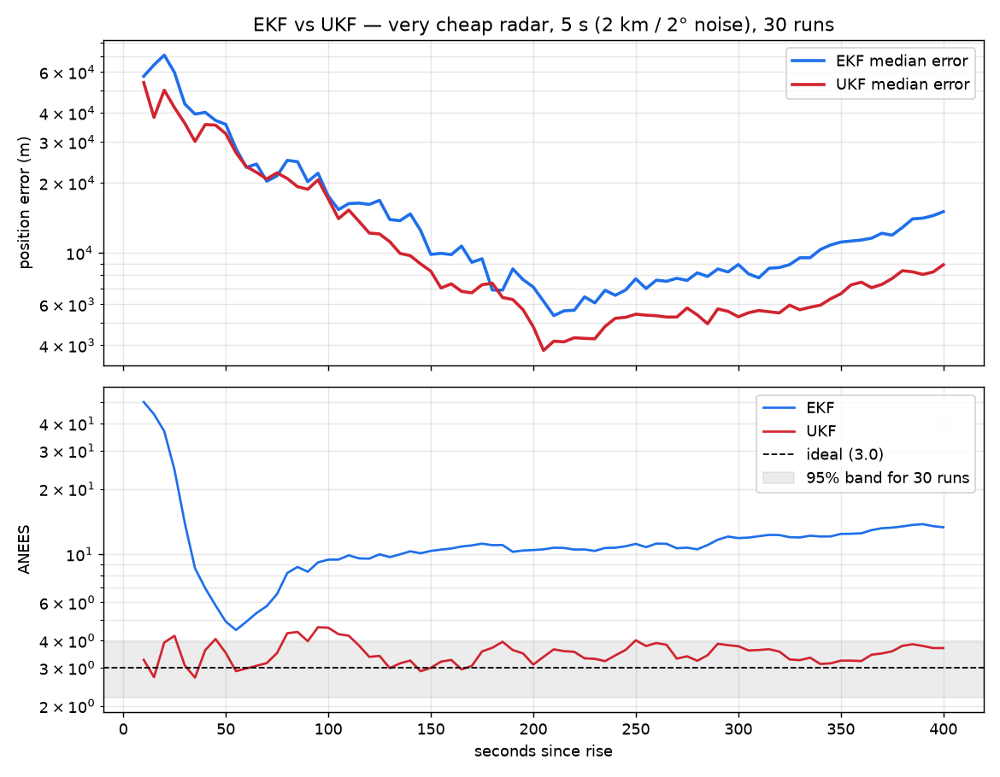
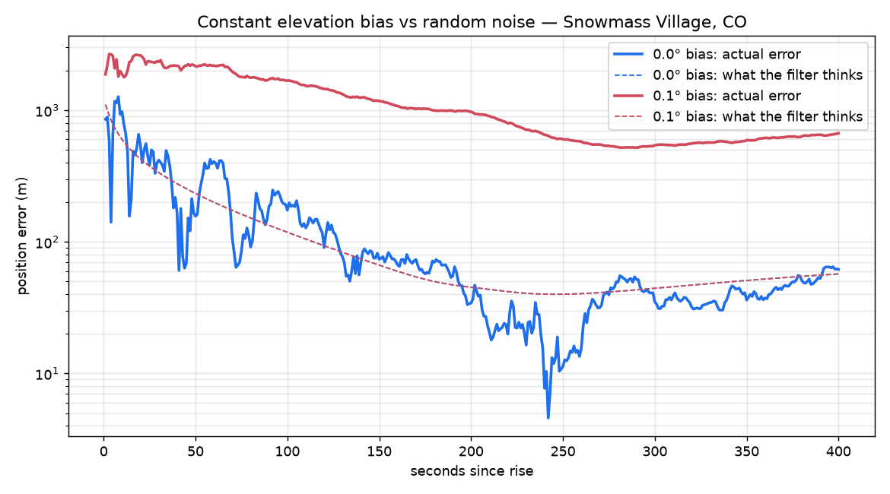

# ISS Tracker

**[Interactive showcase →](https://charleythebad.github.io/iss-tracker/)**: the ground track, sky path, radar noise and both filters, live in your browser.

Predicts when the International Space Station passes overhead, whether you can
see it, and tracks it through a pass with an Extended Kalman Filter fed by
simulated radar measurements.

Everything runs from public orbital data (CelesTrak) and standard, textbook
methods.

## What it does

| Script | Output |
|---|---|
| `iss_now.py` | Where the ISS is right now: latitude, longitude, altitude, speed |
| `iss_passes.py` | Upcoming passes over your location for the next 3 days; `--visible` keeps only the ones you can see |
| `kalman_track.py` | Simulated radar tracking of one pass, filtered with an EKF; prints an error table and saves a plot |
| `export_site_data.py` | Writes `docs/data.json` for the interactive showcase page (`docs/index.html`) |
| `compare_filters.py` | EKF vs Unscented Kalman Filter across four radar-quality scenarios, 30 Monte Carlo runs each |

## Setup

```sh
python3 -m venv .venv
.venv/bin/pip install -r requirements.txt
cp config.example.json config.local.json   # then edit to your location
.venv/bin/python iss_now.py
.venv/bin/python iss_passes.py --visible
.venv/bin/python kalman_track.py
```

`config.local.json` is gitignored. `ISS_CONFIG=path/to/file.json` points the
scripts at a different observer file.

The first run downloads the ISS orbital elements (cached for a day) and NASA
JPL's DE421 ephemeris (~17 MB, used for the sun's position) into `data/`.

## How it works

**Orbit prediction.** CelesTrak publishes the ISS orbit as a Two-Line Element
set (TLE). The SGP4 propagator, the standard model for TLEs, turns it into
position and velocity at any time. Skyfield wraps SGP4 and handles the
coordinate frames.

**Pass visibility.** A pass is visible when two things are true at once: the
ISS is in sunlight, and the observer's sky is dark (sun more than 6° below the
horizon). Each pass is sampled every 10 seconds and the visible window is the
stretch where both hold.

**Tracking with an Extended Kalman Filter.** A simulated ground radar measures
the station's range, azimuth and elevation once per second, with Gaussian noise
(30 m in range, 0.03° in angle). The real SGP4 orbit is the ground truth; the
filter never sees it. The filter:

1. **Starts** from the first two raw measurements only: position from the
   second fix, velocity from the difference between the two. The starting
   uncertainty is the radar noise mapped into position space, so a noisier
   radar starts with honestly larger uncertainty (see the finding below).
2. **Predicts** the next state with physics: two-body gravity plus J2 (Earth's
   equatorial bulge), integrated with fourth-order Runge-Kutta.
3. **Corrects** the prediction with each new measurement, weighting the two by
   their uncertainties. The measurement model converts position into
   range/azimuth/elevation; its Jacobian is computed numerically.
4. **Tracks its own uncertainty** (the covariance), so you can check whether
   it is honest about how wrong it might be.

Azimuth residuals are wrapped to ±180° so a pass crossing north (0°/360°)
doesn't produce a false 360° error.

## Results

One pass over Snowmass Village, CO (peak 57.6°), 401 measurements at 1 s:


- Raw radar fixes are off by hundreds of meters to ~2 km. They're worst near
  the horizon, where the ISS is ~2,000 km away and a 0.03° angle error becomes
  over a kilometer of position.
- The filter converges from ~1 km to under 100 m within about two minutes. Over
  the second half of the pass its RMS error is ~38 m against ~680 m for raw
  fixes, roughly an 18× improvement.
- The filter's actual error stays close to its own 1σ estimate (dashed line),
  so the filter is consistent: neither overconfident nor overly cautious.

## EKF vs UKF

The Unscented Kalman Filter (`ukf.py`) skips Jacobians. It pushes 13 "sigma
points" through the real nonlinear orbit and radar models and rebuilds the mean
and covariance from where they land. Azimuth is averaged on the circle, so
sigma points at 359° and 1° average to 0°, not 180°.

`compare_filters.py` runs both filters on identical data: same pass, same
noise draws, 30 Monte Carlo runs per scenario.

| Scenario (range / angle noise, update rate) | Filter | 2nd-half RMS error | ANEES (ideal 3.0) | Time per pass |
|---|---|---|---|---|
| Tracking radar (30 m / 0.03°, 1 s) | EKF | 47 m | 3.39 | 65 ms |
| | UKF | 47 m | 3.40 | 102 ms |
| Cheap radar (500 m / 0.5°, 1 s) | EKF | 740 m | 3.29 | 65 ms |
| | UKF | 800 m | 3.35 | 102 ms |
| Cheap radar (500 m / 0.5°, 10 s) | EKF | 2,161 m | 2.99 | 6 ms |
| | UKF | 2,069 m | 2.86 | 10 ms |
| Very cheap radar (2 km / 2°, 5 s) | EKF | 9,551 m | **11.79** | 13 ms |
| | UKF | **6,270 m** | **3.52** | 21 ms |



**What this shows:**

- **On a good radar the two filters are practically identical**, and the EKF
  is about 1.6× faster. Once converged, the problem is close enough to linear
  that the EKF's Jacobian is a good approximation.
- **On a very noisy radar the EKF becomes overconfident.** Its ANEES sits
  around 10–13 against an ideal 3. ANEES compares squared errors, so its real
  errors are about √(11.8/3) ≈ 2× larger than it claims. The
  UKF stays inside the 95% consistency band and is about a third more accurate.
  With 2° of angle noise, the uncertainty region is large enough that a
  single-point linearization misrepresents it.
- **Engineering takeaway:** the EKF is fine for a precision radar. The UKF
  earns its ~60% extra compute when the sensor is poor or the geometry is
  strongly nonlinear.

**A bug the comparison found.** The first version started both filters with a
fixed 1 km / 1 km/s uncertainty. That's fine for the tracking radar, but with
0.5° of angle noise the first fix can be off by over 10 km. Both filters
started out overconfident, never recovered (ANEES ~290 instead of 3), and on
the noisiest radar 14 of 30 runs diverged. Deriving the starting covariance
from the radar noise fixed it: cheap-radar error fell from ~4.4 km to ~0.7 km,
ANEES returned to ~3.5, and divergences dropped to 0. A regression test now
covers it.

## Radar bias experiment

`bias_experiment.py` runs the same pass with the same random noise twice: once
with a healthy radar, and once with a radar that always reads 0.1° too high in
elevation. Random noise points a different way each time, so it averages out
as readings pile up. A bias points the same way every time, so it doesn't.



| Time | No bias: error | 0.1° bias: error | Filter thinks | Biased run off by |
|---|---|---|---|---|
| 10 s | 975 m | 1,882 m | 600 m | 3× |
| 60 s | 407 m | 2,183 m | 200 m | 11× |
| 120 s | 90 m | 1,448 m | 93 m | 16× |
| 240 s | 8 m | 650 m | 40 m | 16× |
| 360 s | 37 m | 616 m | 52 m | 12× |

- **The error hits a floor.** The healthy filter drops to single-digit meters;
  the biased one stalls around 550–650 m. More readings stop helping.
- **The filter is confident and wrong.** Its uncertainty (the dashed lines) is
  identical in both runs, because it depends on the noise settings and geometry,
  not on whether the readings make sense. The biased filter claims ~40 m while
  it is off by ~650 m, so nothing inside it raises an alarm.
- **Physics pushes back.** A 0.1° error at 500 km is ~870 m, but the floor is
  lower: no real orbit fits readings that are always high, so the filter settles
  between the orbit model and the bad data.

One radar can't detect its own bias. A second radar at another site would
disagree, and a third would show which one is wrong. The fix is to add the bias
to the filter's state and estimate it. The numbers above are from one live pass
(Oct 31, 2026); the script uses the current orbit, so they shift a little from
day to day.

## Tests

```sh
.venv/bin/pip install -r requirements-dev.txt
.venv/bin/python -m pytest
```

24 tests, about 4 seconds, no network. They use a saved TLE
(`tests/fixtures/iss.tle`), a fixed start time and the example observer, so
results don't depend on today's orbit data. The visibility tests need
`data/de421.bsp` and skip if it hasn't been downloaded yet.

| Area | What's checked |
|---|---|
| Geometry | Range/azimuth/elevation match Skyfield to 1e-6; measurement → position → measurement round-trips; azimuth residual wraps through north |
| Dynamics | Gravity magnitude at ISS altitude; J2 is a 1e-4–3e-3 correction; RK4 conserves orbital energy and polar angular momentum to 1e-9 over a full orbit; propagation stays within 10 m of SGP4 over 2 minutes (measured: 0.76 m) |
| Passes | Rise < peak < set, peak above 10°, sensible durations and spacing; every visible window is sunlit under a dark sky; daytime passes are never marked visible |
| UKF | Sigma points reproduce the mean and covariance exactly; circular azimuth mean; matches the EKF on a good radar; NEES-consistent; stays consistent on a 2 km / 2° radar where the EKF does not |
| Regression | Starting covariance scales with radar noise: the EKF stays NEES-consistent on a 0.5° radar (failed with the old fixed 1 km / 1 km/s start) |
| Filter | Second-half RMS error under 100 m and 5× better than raw fixes; **statistical consistency**: over 10 Monte Carlo runs, the average NEES stays inside its 95% chi-square bounds on at least 90% of steps (measured: 99%, mean 3.4 against an ideal 3.0) |

NEES (normalized estimation error squared) checks whether the filter is honest
about its uncertainty: for a consistent filter it follows a chi-square
distribution with 3 degrees of freedom. To confirm the tests can fail, the
filter was broken on purpose. Telling it the radar is 10× noisier than it is
fails the consistency and accuracy tests, and removing the azimuth wrap fails
the geometry test.

## Limitations

- **The radar is simulated.** Measurements are generated from the true orbit
  plus noise. No real sensor data is involved.
- The filter's dynamics model (two-body + J2) is simpler than SGP4, which also
  models drag and other effects. Process noise absorbs the difference over one
  pass. Longer tracking would need a fuller force model.
- Noise is independent and Gaussian, with no missed detections or false
  alarms. Bias can be simulated (see above) but the filter doesn't estimate it.
- Visibility ignores weather, terrain and the ISS's brightness (magnitude).

## Possible next steps

- Track across several passes, propagating through the gaps between them
- Estimate radar bias as part of the state, using two or more radar sites
- Validate pass times against a published source

## Tech

Python · Skyfield · SGP4 · NumPy · Matplotlib
