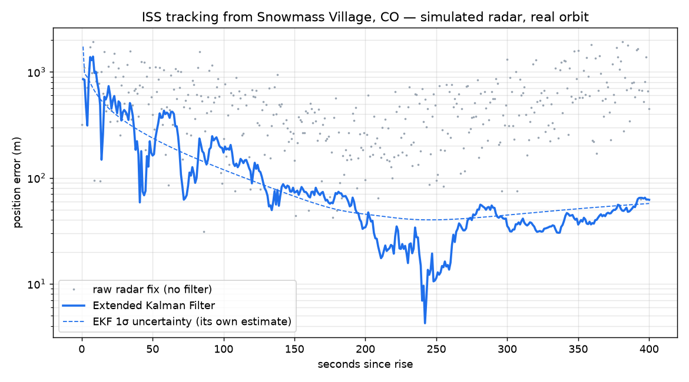

# ISS Tracker

Predicts when the International Space Station passes overhead, whether you can
see it, and tracks it through a pass with an Extended Kalman Filter fed by
simulated radar measurements.

Everything runs from public orbital data (CelesTrak) and standard, textbook
methods.

## What it does

| Script | Output |
|---|---|
| `iss_now.py` | Where the ISS is right now: latitude, longitude, altitude, speed |
| `iss_passes.py` | Upcoming passes over your location for the next 3 days; `--visible` keeps only the ones you can see |
| `kalman_track.py` | Simulated radar tracking of one pass, filtered with an EKF; prints an error table and saves a plot |

## Setup

```sh
python3 -m venv .venv
.venv/bin/pip install -r requirements.txt
cp config.example.json config.local.json   # then edit to your location
.venv/bin/python iss_now.py
.venv/bin/python iss_passes.py --visible
.venv/bin/python kalman_track.py
```

`config.local.json` is gitignored. `ISS_CONFIG=path/to/file.json` points the
scripts at a different observer file.

The first run downloads the ISS orbital elements (cached for a day) and NASA
JPL's DE421 ephemeris (~17 MB, used for the sun's position) into `data/`.

## How it works

**Orbit prediction.** CelesTrak publishes the ISS orbit as a Two-Line Element
set (TLE). The SGP4 propagator, the standard model for TLEs, turns it into
position and velocity at any time. Skyfield wraps SGP4 and handles the
coordinate frames.

**Pass visibility.** A pass is visible when two things are true at once: the
ISS is in sunlight, and the observer's sky is dark (sun more than 6° below the
horizon). Each pass is sampled every 10 seconds and the visible window is the
stretch where both hold.

**Tracking with an Extended Kalman Filter.** A simulated ground radar measures
the station's range, azimuth and elevation once per second, with Gaussian noise
(30 m in range, 0.03° in angle). The real SGP4 orbit is the ground truth; the
filter never sees it. The filter:

1. **Starts** from the first two raw measurements only: position from the
   first fix, velocity from the difference between the first two.
2. **Predicts** the next state with physics: two-body gravity plus J2 (Earth's
   equatorial bulge), integrated with fourth-order Runge-Kutta.
3. **Corrects** the prediction with each new measurement, weighting the two by
   their uncertainties. The measurement model converts position into
   range/azimuth/elevation; its Jacobian is computed numerically.
4. **Tracks its own uncertainty** (the covariance), so you can check whether
   it is honest about how wrong it might be.

Azimuth residuals are wrapped to ±180° so a pass crossing north (0°/360°)
doesn't produce a false 360° error.

## Results

One pass over Snowmass Village, CO (peak 57.6°), 401 measurements at 1 s:



- Raw radar fixes are off by hundreds of meters to ~2 km. They're worst near
  the horizon, where the ISS is ~2,000 km away and a 0.03° angle error becomes
  over a kilometer of position.
- The filter converges from ~1 km to under 100 m within about two minutes. Over
  the second half of the pass its RMS error is ~38 m against ~680 m for raw
  fixes, roughly an 18× improvement.
- The filter's actual error stays close to its own 1σ estimate (dashed line),
  so the filter is consistent: neither overconfident nor overly cautious.

## Limitations

- **The radar is simulated.** Measurements are generated from the true orbit
  plus noise. No real sensor data is involved.
- The filter's dynamics model (two-body + J2) is simpler than SGP4, which also
  models drag and other effects. Process noise absorbs the difference over one
  pass. Longer tracking would need a fuller force model.
- Noise is independent and Gaussian, and there are no missed detections, false
  alarms or bias. Real radar data has all of these.
- Visibility ignores weather, terrain and the ISS's brightness (magnitude).

## Possible next steps

- Track across several passes, propagating through the gaps between them
- Compare EKF vs Unscented Kalman Filter on the same data
- Add measurement bias and estimate it as part of the state
- Validate pass times against a published source

## Tech

Python · Skyfield · SGP4 · NumPy · Matplotlib
